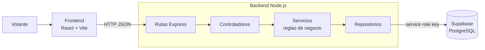

# Sistema de Votaciones Universitarias

[](https://github.com/Hawks-L/Sistema-de-Votaciones-ciberseguridad-/actions/workflows/backend.yml)

Aplicación web para elecciones estudiantiles por sede, facultad y programa. El votante elige su sede, su facultad y su programa, ve solo los candidatos que le corresponden y emite un único voto con su número de identificación.

Además del desarrollo, el proyecto incluye un **análisis de seguridad** del propio sistema: los riesgos encontrados, los controles implementados para mitigarlos, las pruebas que los verifican y lo que queda pendiente.

## Arquitectura



El backend sigue una arquitectura por capas: las **rutas** reciben la petición, los **controladores** manejan la respuesta HTTP, los **servicios** aplican las reglas de la votación y los **repositorios** son la única capa que habla con la base de datos.

## Tecnologías

| Capa | Tecnología |
| --- | --- |
| Frontend | React 19, Vite, Axios |
| Backend | Node.js, Express 5 |
| Base de datos | Supabase (PostgreSQL) |
| Entorno | DevContainer (Node 20) |
| Seguridad | Helmet, express-rate-limit, Zod, CORS con lista blanca |
| Pruebas | Node test runner, Supertest, colección de Postman, GitHub Actions |

## API

| Método | Ruta | Descripción |
| --- | --- | --- |
| GET | `/` | Estado del servidor |
| GET | `/api/sedes` | Lista de sedes |
| GET | `/api/facultades/sede/:sedeId` | Facultades de una sede |
| GET | `/api/programas/facultad/:facultadId` | Programas de una facultad |
| GET | `/api/candidatos/programa/:programaId` | Candidatos de un programa |
| POST | `/api/votos` | Registra un voto |

Ejemplo de voto:

```json
POST /api/votos
{
  "votante_identificacion": "1001234567",
  "sede_id": 1,
  "facultad_id": 2,
  "programa_id": 5,
  "candidato_id": 12
}
```

La colección [`Sistema_Votacion_API.postman_collection.json`](Sistema_Votacion_API.postman_collection.json) trae todas las peticiones listas para importar en Postman.

## Cómo ejecutarlo

Necesitas Node.js 20 y un proyecto de Supabase con las tablas de sedes, facultades, programas, candidatos y votaciones.

```bash
# Backend
cd backend
cp .env.example .env   # completa SUPABASE_URL y SUPABASE_SERVICE_ROLE_KEY
npm install
# aplica db/migrations/001_voto_unico.sql en el editor SQL de Supabase
npm run dev            # http://localhost:3001

# Frontend (en otra terminal)
cd frontend
npm install
npm run dev            # http://localhost:5173
```

También puedes abrir el repositorio en VS Code con **Dev Containers** y las dependencias se instalan solas.

## Análisis de seguridad

### Controles implementados

| Control | Riesgo que mitiga | Dónde |
| --- | --- | --- |
| Restricción `UNIQUE` sobre la identificación del votante | Doble voto por condición de carrera entre la verificación y la inserción | [`db/migrations/001_voto_unico.sql`](backend/db/migrations/001_voto_unico.sql) y `votoRepository.saveVote` |
| Validación estricta con Zod: identificación de 6 a 12 dígitos, ids enteros positivos y rechazo de campos extra | Inyección de datos inesperados y asignación masiva | [`schemas/`](backend/src/schemas) y `middlewares/validate.js` |
| Límite de 5 intentos de voto por IP cada 15 minutos y 100 peticiones generales | Automatización y fuerza bruta de identificaciones | `middlewares/security.js` |
| CORS con lista blanca de orígenes | Llamadas a la API desde sitios de terceros | `middlewares/security.js` |
| Cabeceras HTTP de seguridad con Helmet (CSP, `nosniff`, sin `X-Powered-By`) | Clickjacking, sniffing de contenido y huella del servidor | `middlewares/security.js` |
| Manejo centralizado de errores: mensajes genéricos al cliente y detalle solo en el log | Fuga de información interna de la base de datos | `middlewares/errorHandler.js` |
| Límite de 10 KB en el cuerpo de las peticiones | Denegación de servicio con cuerpos grandes | `app.js` |
| El candidato debe pertenecer a la facultad y al programa elegidos | Votos fuera de la circunscripción del votante | `votoService.registerVote` |
| La clave de Supabase vive solo en el backend y `.env` está ignorado por git | Exposición de credenciales | `config/supabase.js` |
| Dependencias auditadas con `npm audit` en cada push | Vulnerabilidades conocidas en librerías | [GitHub Actions](.github/workflows/backend.yml) |

### Riesgos pendientes

| Riesgo | Severidad | Mitigación planeada |
| --- | --- | --- |
| **Suplantación:** cualquiera que conozca un número de identificación puede votar por esa persona, porque no hay autenticación. El rate limiting lo dificulta, pero no lo impide. | Alta | Autenticación del votante con correo institucional y código de un solo uso. |
| **Privilegios de la clave:** el backend usa la `service_role` key, que ignora las políticas RLS de Supabase. | Media | Políticas RLS y una clave con el mínimo privilegio necesario. |

El análisis sigue las categorías del [OWASP Top 10](https://owasp.org/Top10/): control de acceso (A01), diseño inseguro (A04), configuración de seguridad (A05), componentes vulnerables (A06) y fallas de autenticación (A07).

### Pruebas de seguridad

`backend/test/seguridad.test.js` comprueba con Node test runner y Supertest que la API envía las cabeceras de seguridad, que CORS rechaza orígenes externos, que se rechazan ids e identificaciones inválidas (incluido `1 OR 1=1`), que el JSON mal formado no filtra detalles internos y que el límite de intentos se aplica. Corren en cada push con GitHub Actions.

```bash
cd backend
npm test
```

## Autor

**Leonardo Andrés Estepa Castro** · Ethical Hacker (Cisco Networking Academy) · [Portafolio](https://hawks-l.github.io) · [GitHub](https://github.com/Hawks-L)
