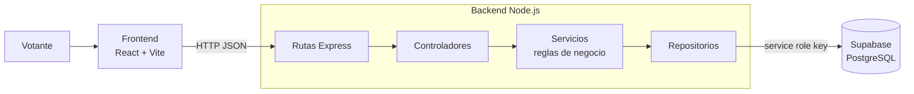

# Sistema de Votaciones Universitarias

Aplicación web para elecciones estudiantiles por sede, facultad y programa. El votante elige su sede, su facultad y su programa, ve solo los candidatos que le corresponden y emite un único voto con su número de identificación.

Además del desarrollo, el proyecto incluye un **análisis de seguridad** del propio sistema: qué controles tiene, qué riesgos siguen abiertos y cómo se van a mitigar.

## Arquitectura



El backend sigue una arquitectura por capas: las **rutas** reciben la petición, los **controladores** manejan la respuesta HTTP, los **servicios** aplican las reglas de la votación y los **repositorios** son la única capa que habla con la base de datos.

## Tecnologías

| Capa | Tecnología |
| --- | --- |
| Frontend | React 19, Vite, Axios |
| Backend | Node.js, Express 5 |
| Base de datos | Supabase (PostgreSQL) |
| Entorno | DevContainer (Node 20) |
| Pruebas de API | Colección de Postman incluida |

## API

| Método | Ruta | Descripción |
| --- | --- | --- |
| GET | `/` | Estado del servidor |
| GET | `/api/sedes` | Lista de sedes |
| GET | `/api/facultades/sede/:sedeId` | Facultades de una sede |
| GET | `/api/programas/facultad/:facultadId` | Programas de una facultad |
| GET | `/api/candidatos/programa/:programaId` | Candidatos de un programa |
| POST | `/api/votos` | Registra un voto |

Ejemplo de voto:

```json
POST /api/votos
{
  "votante_identificacion": "1001234567",
  "sede_id": 1,
  "facultad_id": 2,
  "programa_id": 5,
  "candidato_id": 12
}
```

La colección [`Sistema_Votacion_API.postman_collection.json`](Sistema_Votacion_API.postman_collection.json) trae todas las peticiones listas para importar en Postman.

## Cómo ejecutarlo

Necesitas Node.js 20 y un proyecto de Supabase con las tablas de sedes, facultades, programas, candidatos y votaciones.

```bash
# Backend
cd backend
cp .env.example .env   # completa SUPABASE_URL y SUPABASE_SERVICE_ROLE_KEY
npm install
npm run dev            # http://localhost:3001

# Frontend (en otra terminal)
cd frontend
npm install
npm run dev            # http://localhost:5173
```

También puedes abrir el repositorio en VS Code con **Dev Containers** y las dependencias se instalan solas.

## Análisis de seguridad

### Controles implementados

| Control | Dónde |
| --- | --- |
| Un solo voto por número de identificación | `votoService.registerVote` consulta si ya existe un voto antes de guardar |
| El candidato debe pertenecer a la facultad y al programa elegidos | `votoService.registerVote` |
| Campos obligatorios validados en el servidor, no solo en el formulario | `votoService.registerVote` |
| La clave de Supabase vive solo en el backend y nunca llega al navegador | `config/supabase.js` y `.env` ignorado por git |
| Acceso a datos centralizado en repositorios, sin SQL armado a mano | Cliente de Supabase con consultas parametrizadas |

### Riesgos identificados y plan de mitigación

| Riesgo | Severidad | Mitigación planeada |
| --- | --- | --- |
| **Suplantación:** cualquiera que conozca un número de identificación puede votar por esa persona, porque no hay autenticación. | Alta | Autenticación del votante (correo institucional con código de un solo uso o JWT). |
| **Condición de carrera en el doble voto:** dos peticiones simultáneas con la misma identificación pueden pasar la verificación antes de que se guarde la primera. | Alta | Restricción `UNIQUE` sobre `votante_identificacion` en la base de datos y manejo del error de duplicado. |
| **Automatización y fuerza bruta:** no hay límite de peticiones en `POST /api/votos`. | Media | `express-rate-limit` por IP en la ruta de votos. |
| **CORS abierto:** `cors()` acepta peticiones desde cualquier origen. | Media | Lista blanca con el dominio del frontend. |
| **Validación de tipos:** los campos solo se revisan como obligatorios, no como números o identificaciones válidas. | Media | Esquemas de validación (por ejemplo, Zod) en cada ruta. |
| **Fuga de información en errores:** los mensajes de error de la base de datos se devuelven tal cual al cliente. | Baja | Mensajes genéricos al cliente y detalle solo en los logs del servidor. |
| **Cabeceras HTTP de seguridad ausentes.** | Baja | `helmet`. |
| **Privilegios de la clave:** el backend usa la `service_role` key, que ignora las políticas RLS de Supabase. | Baja | Políticas RLS y una clave con el mínimo privilegio necesario. |

Este análisis sigue las categorías del [OWASP Top 10](https://owasp.org/Top10/): fallas de autenticación (A07), control de acceso (A01), diseño inseguro (A04) y configuración de seguridad (A05).

## Autor

**Leonardo Andrés Estepa Castro** · Ethical Hacker (Cisco Networking Academy) · [Portafolio](https://hawks-l.github.io) · [GitHub](https://github.com/Hawks-L)
